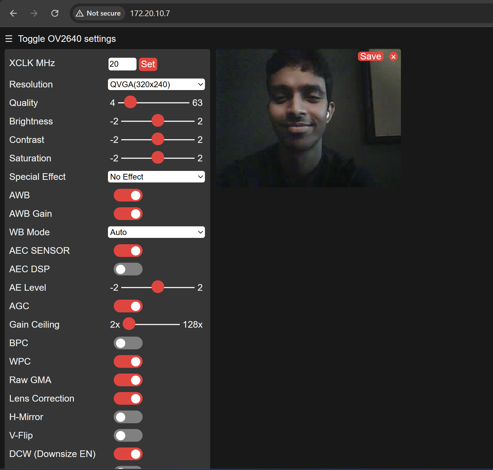
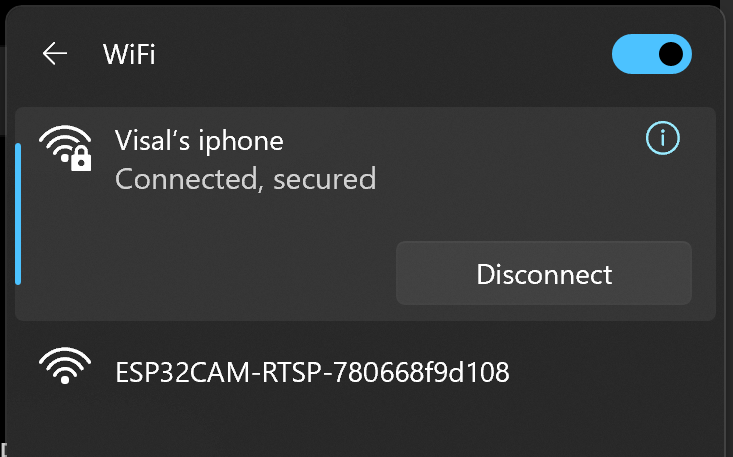
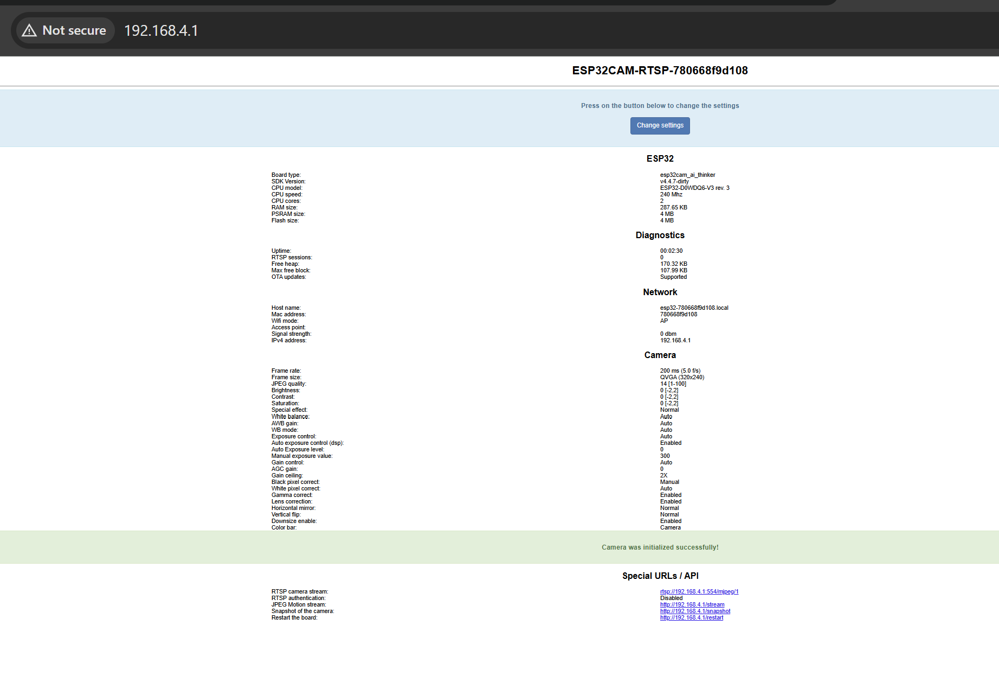
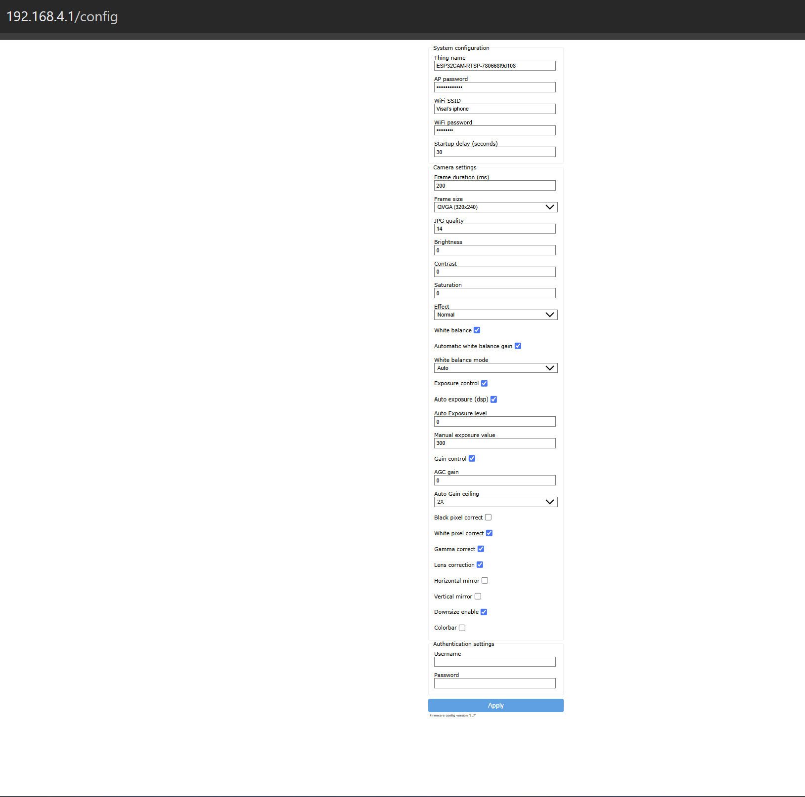
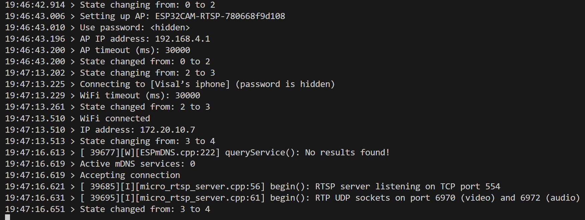
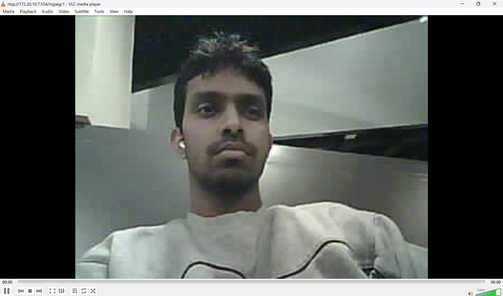
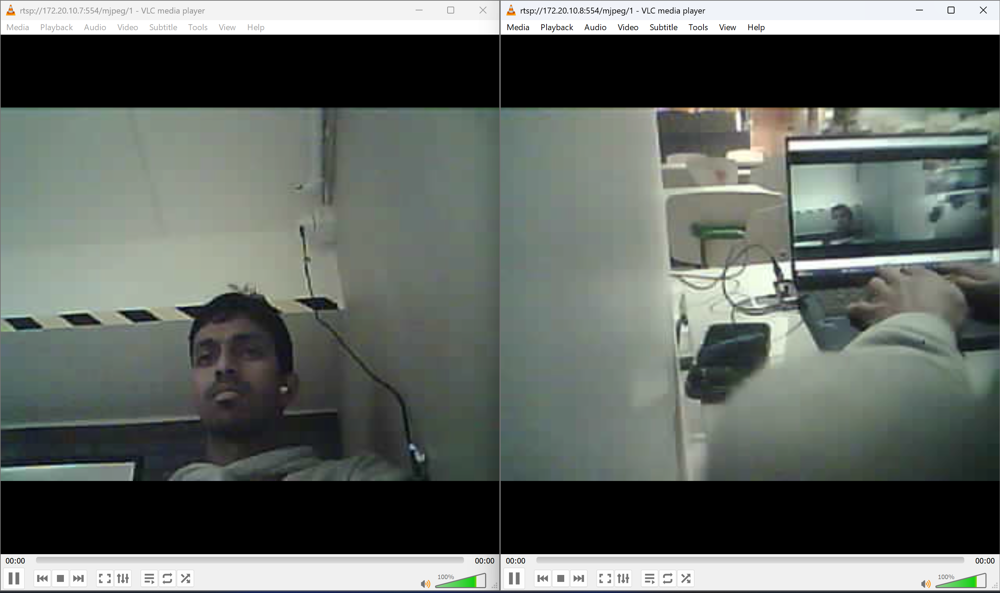

# ESP32-CAM RTSP Performance Testing

Performance evaluation of multiple ESP32-CAM devices
in an RTSP streaming system.

## Hardware

- ESP32-CAM
- OV2640 camera
- ESP32-CAM-MB programmer/development board

## Development Setup

- Arduino IDE 2.3.10
- ESP32 board package by Espressif Systems
- Board configuration: AI Thinker ESP32-CAM
- Serial baud rate: 115200
- Camera model: OV2640
- Wi-Fi: 2.4 GHz

## Progress

### Stage 1 - Basic camera setup
- [x] Install development environment
- [x] Connect ESP32-CAM
- [x] Upload test firmware
- [x] Connect ESP32-CAM to Wi-Fi
- [x] Get IP address
- [x] View camera stream in browser

### Stage 2 - RTSP
- [x] Connect one camera to RTSP system
- [x] View stream using RTSP client

### Stage 3 - Multiple cameras
- [x] Configure second ESP32-CAM
- [x] Stream from two ESP32-CAM devices simultaneously
- [x] Connect cameras to AIoT Garage network
- [x] Integrate camera streams with go2rtc

### Stage 4 - Performance testing
- [ ] FPS
- [ ] Latency
- [ ] Bandwidth
- [ ] Stability

## Basic Camera Test

The ESP32-CAM was first tested using a simple Arduino sketch to verify that firmware could be uploaded and serial communication was working. The sketch is available in `firmware/basic_test/basic_test.ino`.

After restarting the ESP32, the Serial Monitor at 115200 baud displayed: 

`ESP32 is working!`

After the initial test, the `CameraWebServer` example included with the ESP32 Arduino package was used to test the OV2640 camera and Wi-Fi connectivity.

The ESP32-CAM was configured using the `CAMERA_MODEL_AI_THINKER` camera configuration and connected to a 2.4 GHz Wi-Fi network.

After successfull establishment of connection, the ESP32-CAM received a local IP address. The camera web interface was accessed from the laptop connected to the same network. 

Live video from the OV2640 camera was successfully viewed in the browser. This confirmed that the ESP32-CAM, OV2640 camera, Wi-Fi connection and video straming were functioning correclty beofre beginning RTSP testing.



*Figure 1. Live video from the OV2640 camera displayed through the ESP32
CameraWebServer interface.*


## RTSP Setup and Test

After confirming that the ESP32-CAM, OV2640 camera and Wi-Fi connection were working, RTSP streaming was tested using the open-source [ESP32CAM-RTSP](https://github.com/rzeldent/esp32cam-rtsp) project.

Visual Studio Code with the PlatformIO extension was used to build and upload the RTSP frimware. The PlatformIO environment `esp32cam_ai_thinker` was selected for the ESP32-CAM.

The firmware was successfully built and uploaded to the ESP32-CAM.

After restarting the ESP32-CAM, the firmware created its own Wi-Fi access point:

`ESP32CAM-RTSP-780668f9d108`

The access point could then be found from the available Wi-Fi networks on the laptop.



*Figure 2. ESP32CAM-RTSP access point visible in the available Wi-Fi networks.*

The laptop was then connected to the ESP32-CAM access point and the configuration page was opened at:

`http://192.168.4.1`



*Figure 3. ESP32CAM-RTSP status page after connecting directly to the ESP32-CAM access point.*

The status page confirmed that:

- Board type was `esp32cam_ai_thinker`
- PSRAM size was 4 MB
- Flash size was 4 MB
- The camera initialized successfully

The initial camera settings were kept at their default values:

- Resolution: QVGA (320×240)
- Frame duration: 200 ms (5 FPS)
- JPEG quality: 14
- Frame buffers: 2

The ESP32-CAM was then configured to connect to the local Wi-Fi hotspot.

The Wi-Fi SSID and corresponding password were entered in the configuration page while keeping the default camera setting unchanged.



*Figure 4. ESP32CAM-RTSP configuration page used to configure the Wi-Fi connection.*

After applying the configuration and restarting the ESP32-CAM, the device successfully connected to the hotspot.

The PlatformIO Serial Monitor was opened at 115200 baud to observe the connection process. The output confirmed that the ESP32-CAM connected to the Wi-Fi network and that the RTSP server started successfully on TCP port 554.

The assigned IP address during this test was:

`172.20.10.7`



*Figure 5. Serial Monitor confirming the Wi-Fi connection, assigned IP address and successful startup of the RTSP server.*

### Single-Camera RTSP Test

The computer and ESP32-CAM were connected to the same Wi-Fi network.

VLC Media Player was used as the RTSP client.

The following network stream was opened in VLC:

`rtsp://172.20.10.7:554/mjpeg/1`

The live camera video was successfully displayed in VLC.

This confirmed that the ESP32-CAM could operate as an RTSP streaming camera and that the first single-camera RTSP setup was working correctly.



*Figure 6. Live RTSP video from the ESP32-CAM displayed in VLC Media Player.*


### Two-Camera RTSP Test

After successfully testing RTSP stream with a single ESP32-CAM, a second ESP32-CAM was configured with the same RTSP firmware and camera settings.

Both ESP32-CAM devices were connected to the same Wi-Fi hotspot and received separate local IP addresses:

- Camera 1: `172.20.10.7`
- Camera 2: `172.20.10.8`

The laptop was connected to the same Wi-Fi network and the two RTSP stream were opened simultaneously in separate VLC media player windows using:

- Camera 1: `rtsp://172.20.10.7:554/mjpeg/1`
- Camera 2: `rtsp://172.20.10.8:554/mjpeg/1`

Both ESP32-CAM devices successfully displayed live video simultaneously. This confirmed that two ESP32-CAM devices could operate on the same network and provide independent RTSP streams at the same time.



*Figure 7. Simultaneous RTSP streaming from two ESP32-CAM devices displayed in separate VLC Media Player windows.*


### AIoT Garage RTSP Server Integration

After verifying simultaneous RTSP streaming from two ESP32-CAM devices locally, the cameras were connected to the AIoT Garage network for integration with the central RTSP streaming system.

Both ESP32-CAM devices were configured to connect to the AIoT Garage Wi-Fi network while keeping the same camera settings:

- Resolution: QVGA (320×240)
- Frame duration: 200 ms (5 FPS)
- JPEG quality: 14

After connecting to the network, the cameras received separate local IP addresses:

- Camera 1: `192.168.52.141`
- Camera 2: `192.168.52.253`

The RTSP streams were first verified directly using VLC Media Player:

- Camera 1: `rtsp://192.168.52.141:554/mjpeg/1`
- Camera 2: `rtsp://192.168.52.253:554/mjpeg/1`

Both streams were successfully displayed.

The camera streams were then integrated with the go2rtc streaming application running on the AIoT Garage server. The streams were configured as:

- `esp32cam_0`
- `esp32cam_1`

Both camera streams were successfully accessed through the go2rtc web interface.

This confirmed that the ESP32-CAM RTSP streams could be received and accessed through the central AIoT Garage streaming system.


## Troubleshooting and Challenges

The following problems were encountered while progressing through different stages in this project. The solutions and verification steps are documented to make the setup easier to reproduce. 

### ESP32-CAM upload fails with "No serial data received"

**Problem**

When uploading firmware through Arduino IDE, compilation completed successfully, but the upload failed with:

> Failed to connect to ESP32: No serial data received.

The correct COM port was selected and the ESP32-CAM was connected through USB.

**Solution**

The ESP32 needed to be placed into flashing/download mode manually following these steps.

1. Hold the **FLASH** button.
2. Press and release the **RST** button.
3. Keep **FLASH** pressed briefly.
4. Release **FLASH**.
5. Upload the sketch from Arduino IDE.

After entering flashing mode correctly, the firmware uploaded successfully.

**Verification**

The Serial Monitor was opened at **115200 baud** and the **RST** button was pressed.

The ESP32 successfully printed:

`ESP32 is working!`

---

### ESP32-CAM does not connect to iPhone hotspot

**Problem**

After configuring the ESP32-CAM to connect to an iPhone hotspot, the Serial Monitor continuously displayed:

`WiFi connecting................................`

The ESP32-CAM did not initially connect to the hotspot.

**Solution**

The laptop network information showed that the iPhone hotspot was operating on the 5 GHz Wi-Fi band. Since the ESP32 uses 2.4 GHz Wi-Fi, **Maximize Compatibility** was enabled in the iPhone Personal Hotspot settings.

The `WiFiScan` example in Arduino IDE was also used to check whether the ESP32 could detect the hotspot.

The ESP32 successfully detected:

`Visal’s iphone | -45 dBm | Channel 6 | WPA2`

This confirmed that the ESP32 Wi-Fi and antenna were working and that the hotspot was available on a compatible network.

The exact hotspot SSID and password were then used in the CameraWebServer program.

**Verification**

After uploading and restarting the ESP32-CAM, the Serial Monitor displayed:

`WiFi connecting...`

`WiFi connected`

`Camera Ready! Use 'http://172.20.10.7' to connect`

The ESP32-CAM was successfully connected to the iPhone hotspot.

---

### Old Serial Monitor output caused misleading camera error

**Problem**

While testing the CameraWebServer program, the Serial Monitor showed the following errors:

> Detected camera not supported.

> Camera probe failed with error 0x106 (ESP_ERR_NOT_SUPPORTED)

> Camera init failed with error 0x106

This initially appeared to indicate a problem with the OV2640 camera or the ESP32-CAM configuration.

**Solution**

The camera was confirmed to be an **OV2640**, and `CAMERA_MODEL_AI_THINKER` was correctly selected in the CameraWebServer configuration.

The Serial Monitor was then cleared before running the ESP32-CAM again. It was discovered that the previous camera errors were old output remaining from earlier runs and were being confused with the current output.

Clearing the Serial Monitor made it possible to observe only the messages from the latest boot.

**Verification**

After clearing the Serial Monitor and restarting the ESP32-CAM, the output showed:

`WiFi connecting...`

`WiFi connected`

`Camera Ready! Use 'http://172.20.10.7' to connect`

Opening the IP address in the browser successfully displayed the **ESP32 OV2640 camera web interface**.

This showed that the camera and CameraWebServer were working correctly.

---

### ESP32CAM-RTSP cannot find the configured iPhone hotspot

**Problem**

After configuring the ESP32CAM-RTSP firmware to connect to the iPhone hotspot, the ESP32-CAM was unable to find the configured Wi-Fi network.

The Serial Monitor displayed:

`Reason: 201 - NO_AP_FOUND`

The ESP32-CAM therefore did not connect to the hotspot or receive a local IP address.

**Solution**

The iPhone Personal Hotspot settings were checked and **Allow Others to Join** and **Maximize Compatibility** were enabled.

The iPhone Personal Hotspot settings page was kept open while the ESP32-CAM was restarted.

The ESP32CAM-RTSP firmware first created its own configuration access point and waited for 30 seconds before attempting to connect to the configured Wi-Fi network. Therefore, the Serial Monitor was observed until the connection attempt started.

**Verification**

After restarting the ESP32-CAM and waiting for the startup period, the Serial Monitor displayed:

`Connecting to [Visal’s iphone]`

followed by:

`WiFi connected`

`IP address: 172.20.10.7`

The RTSP server then started successfully:

`RTSP server listening on TCP port 554`

The stream was successfully opened in VLC using:

`rtsp://172.20.10.7:554/mjpeg/1`

Live video from the ESP32-CAM was displayed successfully.

---

### PlatformIO `pio` command not recognized in PowerShell

**Problem**

When attempting to build the RTSP firmware from the VS Code PowerShell terminal using:

`pio run -e esp32cam_ai_thinker`

PowerShell returned:

> pio : The term 'pio' is not recognized as the name of a cmdlet, function, script file, or operable program.

The PlatformIO extension was already installed in Visual Studio Code.

**Solution**

Instead of using the `pio` command directly from PowerShell, the PlatformIO graphical project tasks in Visual Studio Code were used.

The firmware was built from:

`PlatformIO → Project Tasks → esp32cam_ai_thinker → General → Build`

The firmware was then uploaded using:

`PlatformIO → Project Tasks → esp32cam_ai_thinker → General → Upload`

**Verification**

PlatformIO successfully completed the build and displayed a successful build status.

The firmware upload also completed successfully for:

`esp32cam_ai_thinker`

The ESP32-CAM restarted with the ESP32CAM-RTSP firmware and created its configuration access point.

---

### ESP32CAM-RTSP configuration remained after reflashing firmware

**Problem**

While preparing the ESP32-CAM for connection to the AIoT Garage network, the password for the ESP32CAM-RTSP configuration access point was no longer known.

The ESP32CAM-RTSP firmware was uploaded again using the PlatformIO environment:

`esp32cam_ai_thinker`

However, after reflashing and restarting the ESP32-CAM, the previous configuration was still present and the access point continued to require the previously configured password.

**Solution**

It was discovered that uploading the firmware again did not remove the previously stored configuration.

The ESP32 flash memory was therefore completely erased using the PlatformIO executable directly from PowerShell:

```powershell
& "C:\Users\vis9M\.platformio\penv\Scripts\platformio.exe" run -e esp32cam_ai_thinker -t erase
```

The ESP32-CAM was placed into flashing/download mode using the **FLASH** and **RST** buttons before performing the erase.

After the flash memory was successfully erased, the ESP32CAM-RTSP firmware was uploaded again using the `esp32cam_ai_thinker` environment.

**Verification**

After restarting the ESP32-CAM, the Serial Monitor showed that the previous configuration had been removed and the device started in its initial configuration mode.

The ESP32-CAM created its configuration access point again and the configuration interface at:

`http://192.168.4.1`

could be accessed.

The ESP32-CAM was then successfully configured for the AIoT Garage Wi-Fi network.

---

### ESP32-CAM Wi-Fi connection fails with `4WAY_HANDSHAKE_TIMEOUT`

**Problem**

While connecting the second ESP32-CAM to the AIoT Garage Wi-Fi network, the device detected the network but failed to establish the connection.

The Serial Monitor displayed:

`Reason: 15 - 4WAY_HANDSHAKE_TIMEOUT`

The ESP32-CAM therefore did not initially receive an IP address from the AIoT Garage network.

**Solution**

The ESP32CAM-RTSP configuration interface was opened by connecting to the ESP32-CAM configuration access point.

The AIoT Garage Wi-Fi credentials were entered again and the configuration was saved.

The ESP32-CAM was then restarted and allowed to reconnect to the configured Wi-Fi network.

**Verification**

After restarting, the Serial Monitor displayed:

`WiFi connected`

The second ESP32-CAM received the local IP address:

`192.168.52.253`

The RTSP server also started successfully on TCP port 554.

The camera stream was then successfully opened in VLC using:

`rtsp://192.168.52.253:554/mjpeg/1`

This confirmed that the ESP32-CAM had successfully connected to the AIoT Garage network and that its RTSP stream was accessible.


### Challenge — Damaged Camera Ribbon Cables and Replacement Camera Initialization Failure

**Problem:**

During hardware development, the ribbon cables of the original ESP32-CAM camera modules were accidentally damaged, making the cameras unusable. Two replacement camera modules, advertised by the vendor as OV2640 sensors, were obtained.

After installing the replacement modules, one camera worked successfully, while the other, marked `XRZ0F3M-V240-V2.0`, failed during initialization.

**Error message:**

```text
E (87) i2c.master: I2C transaction timeout detected
E (87) sccb-ng: SCCB_Write Failed addr:0x30, reg:0x3e, data:0x00, ret:259
E (87) camera: Camera probe failed with error 0xffffffff(ESP_FAIL)
Camera init failed with error 0xffffffff
```

**Troubleshooting steps:**

1. Checked the camera ribbon-cable connections.
2. Tested the working replacement camera (`OV2640-75MM`) on both ESP32-CAM boards.
3. Confirmed that the working camera operated successfully on both boards.
4. Tested the failing replacement camera (`XRZ0F3M-V240-V2.0`) on both ESP32-CAM boards.
5. Observed the same camera initialization error on both boards.

**Findings:**

Both ESP32-CAM boards were able to operate the known-working camera module. The initialization failure followed the second replacement camera when it was moved between boards.

This suggests that the second replacement camera module may be defective or incompatible, rather than the ESP32-CAM boards being faulty.

**Solution / Current status:**

A new OV2640 camera module was ordered to replace the failing module. Delivery is expected by 30 November 2026.

**Verification pending:**

Once the replacement arrives, its initialization and RTSP streaming functionality will be tested before proceeding with simultaneous two-camera performance measurements.

**Lesson learned:**

Camera ribbon cables and connectors should be handled carefully, with power disconnected during installation or removal. When camera initialization fails, swapping camera modules between known-working boards can help isolate whether the problem originates from the camera module or the ESP32-CAM board.
